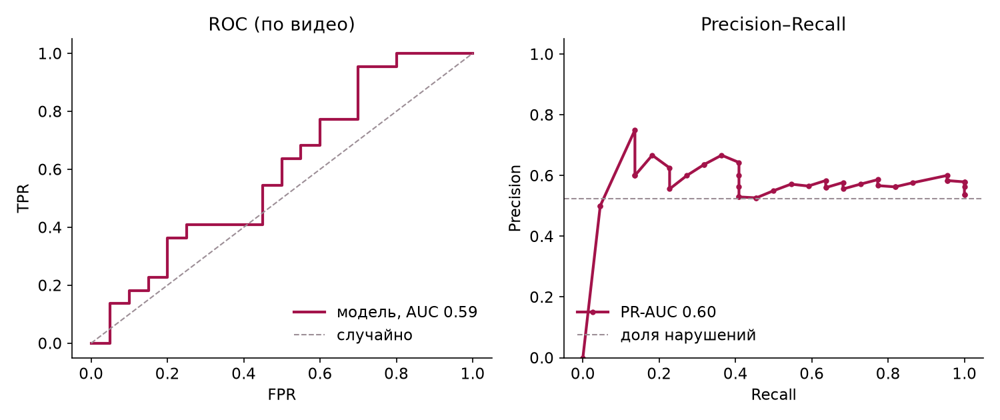
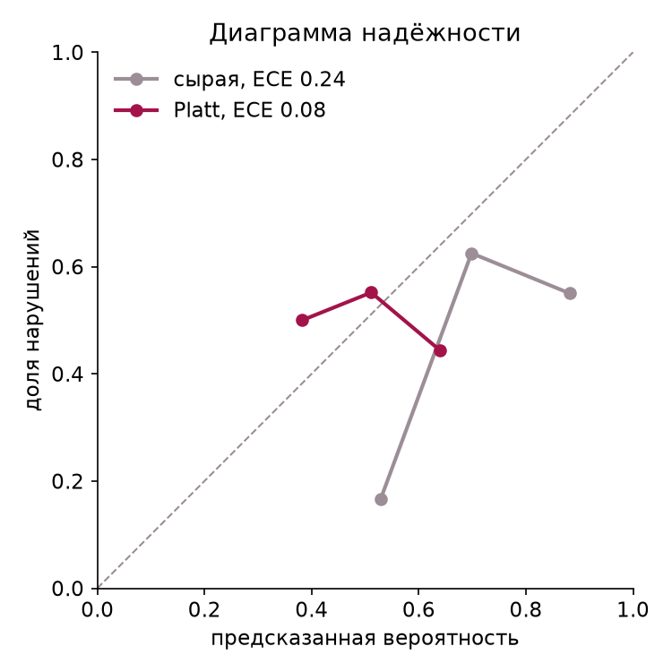
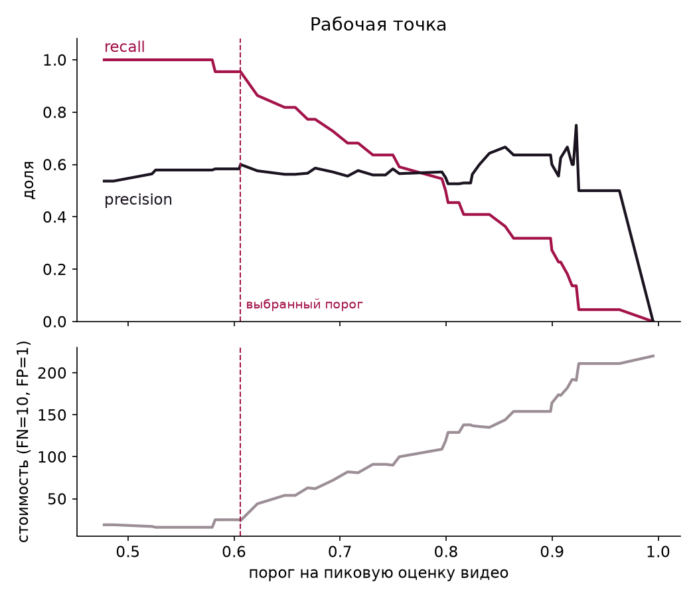
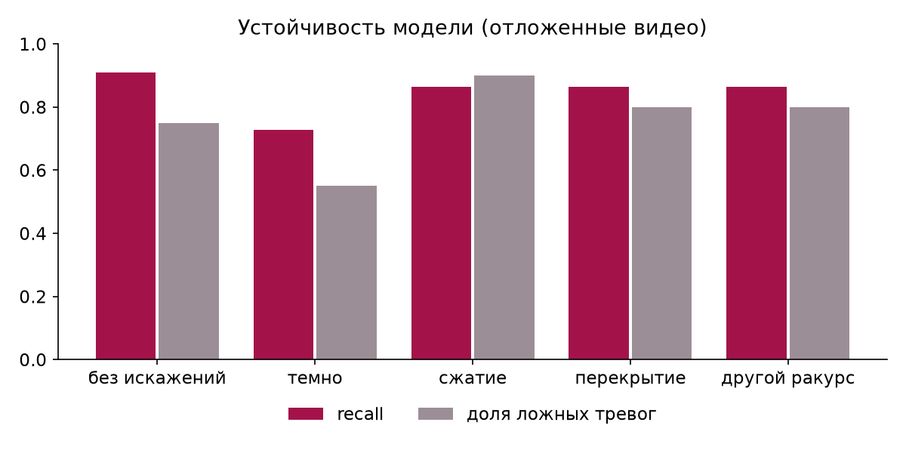

# CashGuard — отчёт о качестве модели

Сформирован 2026-10-17 21:09 командой `python ml/report.py`. Для разработчиков: в интерфейс не выводится.

Модель: PCA k=16, C=0.1, порог 0.6061, 42 видео, 10 фолдов по роликам. Все цифры ниже — на видео, не участвовавших в обучении.

## 1. Классификация (вердикт по видео)

| Метрика | Модель | Сервис (правила + модель) | Пояснение |
|---|---|---|---|
| Precision | 0.60 | 0.58 | доля флагов, которые оказались нарушениями |
| Recall (чувствительность) | 0.95 | 0.95 | доля нарушений, которые поймали |
| F1 | 0.74 | 0.72 | гармоническое среднее precision и recall |
| F2 | 0.85 | 0.85 | recall весит вдвое больше: пропуск дороже |
| Accuracy | 0.64 | 0.62 | при 22/20 классах слабая метрика |
| Specificity | 0.30 | 0.25 | доля чистых роликов, пропущенных верно |
| FPR | 0.70 | 0.75 | ложные тревоги / чистые |
| FNR | 0.05 | 0.05 | пропуски / нарушения |
| ROC-AUC | 0.59 | — | ранжирование без порога |
| PR-AUC (AP) | 0.60 | — | то же для класса «нарушение» |
| MCC | 0.34 | 0.29 | главный критерий отбора модели |
| Cohen's kappa | 0.26 | 0.21 | согласие с разметкой сверх случайного |
| Brier | 0.30 | — | квадрат ошибки оценки |

Матрицы ошибок:

|  | TP | FN | FP | TN |
|---|---|---|---|---|
| Модель | 21 | 1 | 14 | 6 |
| Сервис | 21 | 1 | 15 | 5 |
| Только правила | 4 | 18 | 4 | 16 |
| Всегда «нарушение» | 22 | 0 | 20 | 0 |

### По типам нарушений

Тип — по нашей разметке `ml/violation_types.csv`. «Найдено» — вердикт по видео; «точный тип» — сервис назвал именно этот тип.

| Тип | Видео | Найдено сервисом | моделью | правилами | Точный тип | Медиана |Δt|, с |
|---|---|---|---|---|---|---|
| workplace_left_open | 4 | 4 | 4 | 1 | 0 | 4.50 |
| cash_left_open | 3 | 3 | 3 | 0 | 0 | 5.00 |
| outsider_entered | 3 | 3 | 3 | 0 | 0 | 9.00 |
| cash_counting_hidden | 2 | 1 | 1 | 0 | 0 | 50.00 |
| personal_items_in_cash_zone | 2 | 2 | 2 | 0 | 0 | 7.20 |
| cash_counted_without_control | 1 | 1 | 1 | 1 | 0 | 0.80 |
| cash_door_left_open | 1 | 1 | 1 | 0 | 0 | 1.50 |
| cash_to_pocket | 1 | 1 | 1 | 0 | 0 | 8.00 |
| cashier_uses_phone | 1 | 1 | 1 | 1 | 1 | 1.50 |
| client_left_before_count | 1 | 1 | 1 | 0 | 0 | 9.00 |
| collection_bag_procedure | 1 | 1 | 1 | 0 | 0 | 1.50 |
| safe_left_open | 1 | 1 | 1 | 0 | 0 | 5.00 |
| second_visitor_during_service | 1 | 1 | 1 | 1 | 1 | 3.50 |

## 2. Калибровка и порог

ECE сырой оценки 0.24, после калибровки Platt 0.08 (калибровка оценена leave-one-out). Brier после калибровки 0.26. Калибровка улучшила ECE и применяется: поле `confidence` в отчёте — калиброванная вероятность.

Рабочая точка: порог 0.6061 выбран по максимуму MCC на отложенных оценках. Стоимость ошибок при FN=10, FP=1: 24 (0.57 на видео). Порог с минимальной стоимостью: 0.5794 (TP 22, FP 16, стоимость 16). Веса стоимости задаёт банк: `COST_FN`, `COST_FP` в `backend/app/training.py`.

| Порог | TP | FP | FN | Precision | Recall | F2 | MCC | Стоимость |
|---|---|---|---|---|---|---|---|---|
| 0.48 | 22 | 19 | 0 | 0.54 | 1.00 | 0.85 | 0.16 | 19.00 |
| 0.58 | 22 | 16 | 0 | 0.58 | 1.00 | 0.87 | 0.34 | 16.00 |
| 0.61 | 21 | 14 | 1 | 0.60 | 0.95 | 0.85 | 0.34 | 24.00 |
| 0.62 | 19 | 14 | 3 | 0.58 | 0.86 | 0.79 | 0.20 | 44.00 |
| 0.68 | 17 | 12 | 5 | 0.59 | 0.77 | 0.73 | 0.19 | 62.00 |
| 0.73 | 14 | 11 | 8 | 0.56 | 0.64 | 0.62 | 0.09 | 91.00 |
| 0.80 | 12 | 9 | 10 | 0.57 | 0.55 | 0.55 | 0.10 | 109.00 |
| 0.82 | 9 | 8 | 13 | 0.53 | 0.41 | 0.43 | 0.01 | 138.00 |
| 0.84 | 9 | 5 | 13 | 0.64 | 0.41 | 0.44 | 0.17 | 135.00 |
| 0.90 | 6 | 4 | 16 | 0.60 | 0.27 | 0.31 | 0.09 | 164.00 |
| 0.92 | 3 | 2 | 19 | 0.60 | 0.14 | 0.16 | 0.06 | 192.00 |
| 0.96 | 1 | 1 | 21 | 0.50 | 0.05 | 0.06 | -0.01 | 211.00 |

## 3. Переобучение и недообучение

ROC-AUC по моментам: обучение 0.76, отложенные 0.61, разрыв 0.15 → **overfit** (порог переобучения 0,15).

| k | C | MCC | F1 | ROC-AUC | TP | FP | FN |  |
|---|---|---|---|---|---|---|---|---|
| 8 | 0.01 | 0.22 | 0.40 | 0.53 | 6 | 2 | 16 |  |
| 8 | 0.10 | 0.22 | 0.40 | 0.53 | 6 | 2 | 16 |  |
| 8 | 1.00 | 0.22 | 0.40 | 0.53 | 6 | 2 | 16 |  |
| 16 | 0.01 | 0.34 | 0.73 | 0.59 | 22 | 16 | 0 |  |
| 16 | 0.10 | 0.34 | 0.74 | 0.59 | 21 | 14 | 1 | выбрано |
| 16 | 1.00 | 0.34 | 0.74 | 0.59 | 21 | 14 | 1 |  |
| 32 | 0.01 | 0.23 | 0.71 | 0.54 | 22 | 18 | 0 |  |
| 32 | 0.10 | 0.23 | 0.71 | 0.55 | 22 | 18 | 0 |  |
| 32 | 1.00 | 0.29 | 0.72 | 0.55 | 22 | 17 | 0 |  |
| 64 | 0.01 | 0.17 | 0.34 | 0.48 | 5 | 2 | 17 |  |
| 64 | 0.10 | 0.17 | 0.34 | 0.48 | 5 | 2 | 17 |  |
| 64 | 1.00 | 0.16 | 0.70 | 0.47 | 22 | 19 | 0 |  |

## 4. Справедливость и устойчивость

**Защищённые признаки.** Пол, возраст, этническая принадлежность в данных отсутствуют и не извлекаются: распознавание лиц запрещено условиями кейса, сервис не идентифицирует людей. Поэтому подгрупповой анализ по защищённым признакам и метрики demographic parity / equalized odds посчитать нельзя. Для аудита нужна отдельная разметка видео по этим признакам с согласия сотрудников. Вместо этого ниже — разрез по условиям съёмки (сервис целиком).

**Яркость кадра**

| Группа | Диапазон | Видео | Accuracy | Recall | FPR | MCC |
|---|---|---|---|---|---|---|
| тёмные | 119.6–136.5 | 15 | 0.67 | 1.00 | 0.71 | 0.42 |
| средние | 136.6–138.8 | 13 | 0.77 | 1.00 | 0.60 | 0.54 |
| светлые | 138.9–143.3 | 14 | 0.43 | 0.83 | 0.88 | -0.06 |

**Длина видео, с**

| Группа | Диапазон | Видео | Accuracy | Recall | FPR | MCC |
|---|---|---|---|---|---|---|
| короткие | 11.6–19.6 | 14 | 0.71 | 1.00 | 0.80 | 0.37 |
| средние | 19.8–26.4 | 14 | 0.71 | 0.89 | 0.60 | 0.34 |
| длинные | 31.7–142.5 | 14 | 0.43 | 1.00 | 0.80 | 0.26 |

**Людей в кадре (среднее)**

| Группа | Диапазон | Видео | Accuracy | Recall | FPR | MCC |
|---|---|---|---|---|---|---|
| мало людей | 0.9–1.0 | 18 | 0.56 | 1.00 | 0.80 | 0.32 |
| средне | 1.0–1.9 | 10 | 0.70 | 1.00 | 1.00 | 0.00 |
| людно | 2.0–2.5 | 14 | 0.64 | 0.86 | 0.57 | 0.32 |

Наибольший разрыв recall между группами: 0.17, FPR: 0.43 (аналог equalized odds gap по условиям съёмки).

**Искажения кадра.** Каждый ролик перекодирован с искажением и заново пропущен через CLIP (1 кадр в секунду, чистые ролики для сравнения прорежены так же); оценивает модель фолда, которая этот ролик не видела. Порог тот же, что в сервисе.

| Условие | Что сделано | Recall | FPR | MCC | ROC-AUC |
|---|---|---|---|---|---|
| чистые | без искажений | 0.91 | 0.75 | 0.21 | 0.59 |
| dark | освещение ×0,35 | 0.73 | 0.55 | 0.18 | 0.63 |
| compressed | ½ разрешения, JPEG q=12 | 0.86 | 0.90 | -0.06 | 0.50 |
| occluded | чёрный блок 35% кадра | 0.86 | 0.80 | 0.09 | 0.46 |
| angle | перспектива + поворот 7° (имитация другого ракурса) | 0.86 | 0.80 | 0.09 | 0.60 |

Проверяли обучение с аугментацией (те же искажённые копии обучающих роликов). При k=16 recall на чистых видео упал с 1,00 до 0,64, при k=32 — до 0,86; темнота и ракурс стали лучше, сжатие хуже (ROC-AUC 0,35). Для политики «пропуск недопустим» это ухудшение, поэтому аугментация не включена.

## 5. Дрейф и работа в эксплуатации

Задач в базе: 9 (готово 9, ошибок 0). Флагов: 7, подтверждено проверяющими: 0. Согласие ответов с вердиктом (kappa): —.

Подтверждений пока нет: дрейф начнёт считаться по неделям с первых ответов проверяющих.

## 6. Юридические и операционные критерии

**Объяснимость.** У 18 из 18 типов есть пункт акта с дословной цитатой и ссылкой на adilet.zan.kz. В прогоне по датасету 14 из 14 флагов сопровождаются нормой.

**Доказательства.** Кадров на нарушение: от 2 до 3 (в среднем 2.43), у каждого кадра таймкод. Кадры хранятся JPEG-файлами, в базе — пути (`evidence_frames`), что позволяет поднять их при аудите.

**Персональные данные.** Сервис хранит минимум: исходное видео удаляется сразу после обработки (`KEEP_VIDEOS=false`), лица не распознаются, звук не используется. Срок хранения ограничен `RETENTION_DAYS`: отчёты и кадры старше срока удаляются, у подтверждённых видео остаются только эмбеддинги и ответ проверяющего. Основание обработки и согласие сотрудников — вопрос к DPO банка (Закон РК «О персональных данных и их защите»); юридическую оценку сервис не даёт.

**Человек в контуре.** На датасете сервис отправляет человеку 36 из 42 видео (86%): каждый флаг — подсказка для проверки. В эксплуатации проверено 0 из 7 флагов.

**Скорость.** Медиана обработки 33.6 с, максимум 146.7 с, от загрузки до ответа не дольше 180.6 с; медианный коэффициент реального времени 1.68 (время обработки / длина видео). Самый длинный ролик датасета (142 с) — 171 с на CPU; лимит 300 с соблюдается за счёт адаптивной частоты кадров.

**Юридическая проверка соответствия.** Сопоставление правил и норм ниже требует подписи юриста или комплаенса банка. Статус у всех строк — «ожидает проверки».

| Тип | Акт | Пункт | Цитата | Ссылка | Статус |
|---|---|---|---|---|---|
| cashier_uses_phone | Правила кассовых операций (пост. Правления НБРК от 29.11.2019 № 231) | п. 12 | есть | https://adilet.zan.kz/rus/docs/V1900019680 | ожидает проверки |
| cash_left_unattended | Правила кассовых операций (пост. Правления НБРК от 29.11.2019 № 231) | п. 20 | есть | https://adilet.zan.kz/rus/docs/V1900019680 | ожидает проверки |
| second_visitor_during_service | Правила кассовых операций (пост. Правления НБРК от 29.11.2019 № 231) | п. 20 | есть | https://adilet.zan.kz/rus/docs/V1900019680 | ожидает проверки |
| workplace_left_open | Правила кассовых операций (пост. Правления НБРК от 29.11.2019 № 231) | п. 20 | есть | https://adilet.zan.kz/rus/docs/V1900019680 | ожидает проверки |
| cashier_left_during_service | Правила кассовых операций (пост. Правления НБРК от 29.11.2019 № 231) | п. 22 | есть | https://adilet.zan.kz/rus/docs/V1900019680 | ожидает проверки |
| unauthorized_person_in_cash_zone | Правила охраны и устройства помещений (пост. Правления НБРК от 24.02.2020 № 14) | п. 8 | есть | https://adilet.zan.kz/rus/docs/V2000020075 | ожидает проверки |
| personal_items_in_cash_zone | Правила кассовых операций (пост. Правления НБРК от 29.11.2019 № 231) | п. 12 | есть | https://adilet.zan.kz/rus/docs/V1900019680 | ожидает проверки |
| camera_obstructed | Правила охраны и устройства помещений (пост. Правления НБРК от 24.02.2020 № 14) | п. 16, пп. 6) (в редакции на период приостановления до 01.01.2027) | есть | https://adilet.zan.kz/rus/docs/V2000020075 | ожидает проверки |
| cash_zone_door_open | Правила охраны и устройства помещений (пост. Правления НБРК от 24.02.2020 № 14) | п. 8 | есть | https://adilet.zan.kz/rus/docs/V2000020075 | ожидает проверки |
| cash_zone_door_open | Правила охраны и устройства помещений (пост. Правления НБРК от 24.02.2020 № 14) | п. 16, пп. 1) (в редакции на период приостановления до 01.01.2027) | есть | https://adilet.zan.kz/rus/docs/V2000020075 | ожидает проверки |
| cash_left_open | Правила кассовых операций (пост. Правления НБРК от 29.11.2019 № 231) | п. 20 | есть | https://adilet.zan.kz/rus/docs/V1900019680 | ожидает проверки |
| safe_left_open | Правила кассовых операций (пост. Правления НБРК от 29.11.2019 № 231) | п. 20 | есть | https://adilet.zan.kz/rus/docs/V1900019680 | ожидает проверки |
| cash_counting_hidden | Правила кассовых операций (пост. Правления НБРК от 29.11.2019 № 231) | п. 20 | есть | https://adilet.zan.kz/rus/docs/V1900019680 | ожидает проверки |
| cash_counting_hidden | Правила кассовых операций (пост. Правления НБРК от 29.11.2019 № 231) | п. 31, пп. 4) | есть | https://adilet.zan.kz/rus/docs/V1900019680 | ожидает проверки |
| cash_counted_without_control | Правила кассовых операций (пост. Правления НБРК от 29.11.2019 № 231) | п. 42 | есть | https://adilet.zan.kz/rus/docs/V1900019680 | ожидает проверки |
| cash_to_pocket | Правила кассовых операций (пост. Правления НБРК от 29.11.2019 № 231) | п. 12 | есть | https://adilet.zan.kz/rus/docs/V1900019680 | ожидает проверки |
| collection_bag_procedure | Правила кассовых операций (пост. Правления НБРК от 29.11.2019 № 231) | п. 24, пп. 3)–4) | есть | https://adilet.zan.kz/rus/docs/V1900019680 | ожидает проверки |
| collection_bag_procedure | Правила кассовых операций (пост. Правления НБРК от 29.11.2019 № 231) | п. 25 | есть | https://adilet.zan.kz/rus/docs/V1900019680 | ожидает проверки |
| outsider_entered | Правила охраны и устройства помещений (пост. Правления НБРК от 24.02.2020 № 14) | п. 8 | есть | https://adilet.zan.kz/rus/docs/V2000020075 | ожидает проверки |
| cash_door_left_open | Правила охраны и устройства помещений (пост. Правления НБРК от 24.02.2020 № 14) | п. 8 | есть | https://adilet.zan.kz/rus/docs/V2000020075 | ожидает проверки |
| cash_door_left_open | Правила охраны и устройства помещений (пост. Правления НБРК от 24.02.2020 № 14) | п. 16, пп. 1) (в редакции на период приостановления до 01.01.2027) | есть | https://adilet.zan.kz/rus/docs/V2000020075 | ожидает проверки |
| client_left_before_count | Правила кассовых операций (пост. Правления НБРК от 29.11.2019 № 231) | п. 35 | есть | https://adilet.zan.kz/rus/docs/V1900019680 | ожидает проверки |
